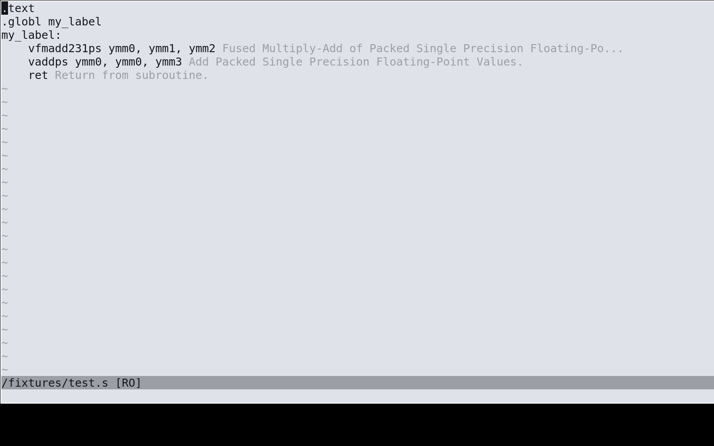
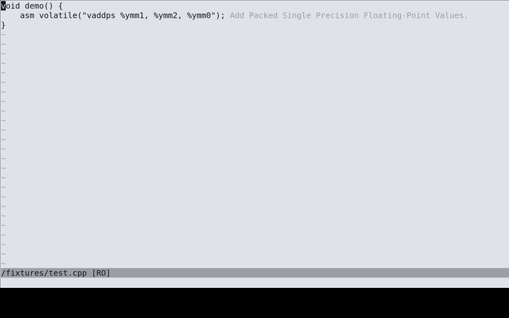

# nvim-simdref

Show the brief of an assembly instruction as an inlay hint.





`K` on an instruction (vim.lsp.buf.hover) shows the full simdref page from the local catalog, no network. `gx` on a URL in it opens the link. Neovim shows the inlay hint label in full; the plugin sets no length cap.

## Requirements

- Neovim 0.11 or newer
- `curl` and `tar`, or `uv`, or `python3` 3.10 or newer

## Install

With a plugin manager, add `simd-labs/nvim-simdref` to your `runtimepath`. Without one:

```
git clone https://github.com/simd-labs/nvim-simdref ~/.local/share/nvim/site/nvim-simdref
```

Then install simdref:

```
uv tool install simdref
isa update
```

or:

```
pip install simdref
isa update
```

## Setup

The plugin starts when a `*.s` or `*.cpp` buffer opens. If the server is not on `PATH`, the plugin installs it in the background to `stdpath('data')/simdref`, then starts it. The install first downloads a pinned uv and checks its sha256; when that fails, the plugin uses `uv` on `PATH` or a `python3` venv. A new simdref version takes effect at the next server start. `:LspRestart` restarts the server without closing Neovim. A server on `PATH` is never upgraded.

If the server is not on `PATH` and the install does not run, the plugin shows:

```
simdref not found. Install it: uv tool install simdref (or pip install simdref), then run isa update. Instructions: https://github.com/simd-labs/simdref
```

## Settings

`vim.g.simdref_disable` (default `false`): set it before the plugin loads to turn the plugin off.
